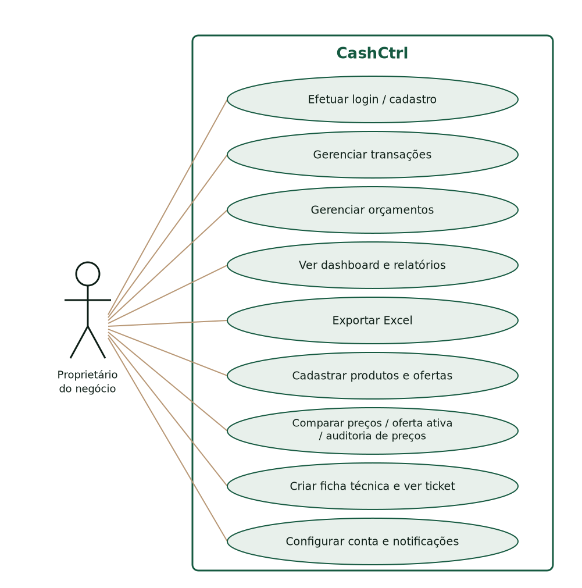
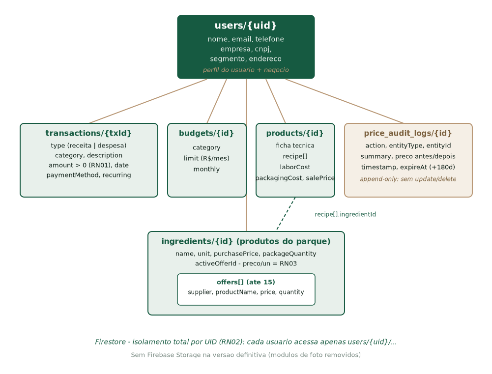

# Respostas aos 42 marcadores pendentes da v0.2

Base de evidência: **versão definitiva do CashCtrl** (commit único `master`, 28/10/2026, `version: 1.0.0+1`, APK release 59 MB). Módulos de foto (image_picker + Firebase Storage) **removidos** desta versão. Itens marcados com ✅ foram verificados no código; 🔧 exigem decisão da equipe; ❓ exigem dado que só a equipe tem. Os itens 6 e 7 deixam de ser 🔧/✅ simples e passam a **VERIFICADO NO CÓDIGO + FIGURA**: as Figuras 1 (casos de uso) e 2 (modelo de dados) foram elaboradas a partir do código e estão anexadas abaixo e embutidas no DOCX `CTRLCASH_RESPOSTAS_V02.docx`.

---

## A. Decisões da equipe

### 1 ✅ Situação real dos módulos citados (RF13–RF17)

| Conceito | Status na versão definitiva | Onde |
|---|---|---|
| Rendimento | **NÃO implementado** — não existe no código | — |
| Custos fixos × variáveis (classificação) | **NÃO implementado** como classificação; existem custos diretos por ficha | — |
| Mão de obra | **Implementado** — campo `laborCost` entra no custo total | `product.dart`, `product_calculator.dart:94` |
| Markup | **Implementado** — `markup = venda ÷ custo total`, exibido no detalhe ("Markup X.XXx") | `product_calculator.dart:34`, `product_detail_screen.dart:221` |
| Contribuição / margem | **Implementado** — `lucro = venda − custo`, `margem% = lucro ÷ venda`, veredito Dá lucro/Prejuízo | `product_calculator.dart:95-98` |
| Ponto de equilíbrio | **NÃO implementado** | — |

🔧 **Decisão sugerida:** o que não existe (rendimento, ponto de equilíbrio, classificação fixo/variável) deve constar na documentação como **evolução futura**, não como entrega. Implementar agora atrasaria a entrega.

### 2 ✅ Controle financeiro (RF01, RF05–RF10)

Já está **implementado e dentro da entrega**: transações (receita/despesa, categorias de negócio, método de pagamento, recorrência), orçamentos mensais com progresso em tempo real, dashboard operacional, relatórios unificados com gráficos (fl_chart) e exportação Excel (3 abas). Telas: `expenses_screen.dart`, `budgets_screen.dart`, `reports_screen.dart`, `home_screen.dart`. 🔧 Decisão restante: apenas manter no escopo (recomendado — já funciona).

### 3 ✅ Mão de obra e custos diretos no custo do lote

**Sim, entram.** Fórmula no código: `custoTotal = Σ(qtd × preço/un do insumo) + mão de obra + embalagem` (`product_calculator.dart:93-94`). A participação percentual de cada item no custo é exibida no ticket (`product_detail_screen.dart`).

### 4 ✅ Markup e mix de vendas

- **Markup atual é informativo (saída), não base de cálculo (entrada):** o app calcula e mostra o markup do preço que o usuário definiu; não sugere preço a partir de um markup-alvo.
- **Mix de vendas:** cada ficha técnica tem preço de venda próprio. Não existe markup único aplicado a vários produtos. Os relatórios têm "Top 5 categorias" e receita × custos dos últimos 6 meses.
- 🔧 **Decisão sugerida:** documentar o markup como indicador calculado (venda ÷ custo) e tratar "precificação por markup-alvo com mix" como evolução futura.

### 5 ✅ Perfis (proprietário × produção/precificação)

**Não existem.** O app é monousuário: cada conta acessa somente seus próprios dados (isolamento por UID no Firestore). Para duas pessoas no mesmo negócio, hoje compartilhariam a mesma conta. 🔧 **Decisão sugerida:** registrar como evolução futura (perfis/roles).

---

## B. Conteúdo técnico

### 6 ✅ Diagrama de casos de uso (VERIFICADO NO CÓDIGO + FIGURA)

Atores: **Proprietário do negócio** (único). Os casos de uso identificados nas telas foram consolidados em 9 casos no diagrama da Figura 1: Efetuar login/cadastro, Gerenciar transações, Gerenciar orçamentos, Ver dashboard e relatórios, Exportar Excel, Cadastrar produtos e ofertas, Comparar preços/oferta ativa/auditoria de preços, Criar ficha técnica e ver ticket, Configurar conta e notificações.

Figura 1 – Diagrama de casos de uso do CashCtrl (fonte: código da versão definitiva v1.0.0+1).



### 7 ✅ Modelo de dados — escolha do banco (VERIFICADO NO CÓDIGO + FIGURA)

**Cloud Firestore** (não Realtime Database). Justificativa: documentos NoSQL, streams em tempo real nativos ao Flutter (`StreamProvider`), regras de segurança por subcoleção e isolamento por UID. Estrutura:

```
users/{uid}                              perfil + dados do negócio
users/{uid}/transactions/{id}            tipo, categoria, valor, data, método, recorrência
users/{uid}/budgets/{id}                 categoria + limite mensal
users/{uid}/ingredients/{id}             produto comprado: nome, unidade, preço de compra,
                                         qtd da embalagem, offers[] (≤15), activeOfferId
users/{uid}/products/{id}                ficha técnica: receita[], laborCost,
                                         packagingCost, salePrice
users/{uid}/price_audit_logs/{id}        auditoria de preços (append-only)
```

Figura 2 – Modelo de dados no Firestore, com isolamento por UID.



### 8 ✅ Estrutura de pastas (atualizada para a versão definitiva)

```
lib/
  main.dart                firebase_options.dart   home_screen.dart
  budgets_screen.dart      expenses_screen.dart    reports_screen.dart  settings_screen.dart
  models/     app_user, transaction, budget, ingredient, ingredient_offer,
              price_audit_log, product
  providers/  user, transaction, budget, ingredient, product
  services/   auth_service.dart, firestore_service.dart, notification_service.dart
              (storage_service.dart REMOVIDO — sem upload de fotos)
  screens/    login, cadastro, transaction_form, budget_form, ingredients (Produtos),
              ingredient_form, ingredient_offers, offer_form, audit_logs, products
              (Fichas Técnicas), product_form, product_detail, compare_prices,
              settings/ (edit_profile, notifications, security, help, terms_privacy)
  theme/  utils/  widgets/
android/  web/  firestore.rules  storage.rules
```

### 9 ✅ Regras de segurança do banco (`firestore.rules`)

- Isolamento total por UID: `allow read, write: if request.auth.uid == uid` em `users/{uid}/...`; não há coleções globais.
- Transações: `create/update` exige `amount` numérico > 0.
- Produtos (ingredients): exige `purchasePrice ≥ 0`.
- Logs de auditoria: **append-only** — `allow read, create`; `update, delete: if false`.

### 10 🔧 Ferramentas de design e UML

O design foi definido **em código** (design system próprio: `theme/app_colors.dart` — fundo `0xFF0D1E16`, verde `0xFF165A41`, dourado `0xFFB89775`) e validado com **protótipos HTML** (em `documentacao/logs/sprint2–4/prototipo_*.html`). Não houve uso de Figma. Para o relatório: desenhar diagramas em draw.io/PlantUML. 🔧 Confirmar com a equipe qual ferramenta declarar.

### 11 ✅ Controle de versão e nome do repositório

Git + GitHub, repositório `https://github.com/JoaoVikthor/ctrlcash`. Nomenclatura real: **CashCtrl** = nome do app (marca, logo camaleão); **ctrlcash** = nome do repositório e do pacote Flutter (`pubspec: name: ctrlcash`). Sugestão para o texto: "CashCtrl (repositório: ctrlcash)". A branch única passa a ser `master` com histórico refeito (um commit).

### 12 ✅ Plataforma, requisitos, web, instalação

- **Android** (plataforma principal; `minSdk` = padrão do Flutter) e **Web** (`flutter build web`). iOS adiado.
- Requisitos: Android com Firebase Auth disponível, ~50 MB de armazenamento, tela sensível ao toque; app funciona em smartphone intermediário.
- Instalação: APK `app-release.apk` (transferir ao aparelho e instalar com "fontes desconhecidas"), ou rodar a versão web no navegador.
- Backend: projeto Firebase `crtlcash-71ac3` (Auth, Firestore).

### 13 ✅ Versão demonstrada

**v1.0.0+1** (`pubspec.yaml`), build definitiva de 28/10/2026 **sem módulos de foto** (decisão da última sprint: a funcionalidade de fotos não salvava corretamente no Firebase Storage e foi removida — perfil exibe apenas iniciais).

### 14 ✅ Nível real de cada módulo (pós-demonstração)

| Módulo | Nível |
|---|---|
| Autenticação (e-mail/senha + redefinir senha) | Completo |
| Cadastro (pessoal + negócio, multi-etapa) | Completo (sem foto) |
| Transações / receitas e despesas | Completo |
| Orçamentos | Completo |
| Dashboard | Completo |
| Relatórios + Excel | Completo |
| Produtos (parque) + ofertas + comparativo + auditoria | Completo |
| Fichas técnicas + ticket (mão de obra, embalagem, markup, margem) | Completo |
| Notificações locais | Completo (orçamento, recorrência, margem) |
| Perfil/segurança/ajuda/termos | Completo (sem upload de foto) |
| Rendimento, ponto de equilíbrio, perfis de usuário | Não implementado (evolução futura) |

---

## C. Evidências e validação

### 15 ✅ Comportamento esperado nos 5 testes (verificado no código)

| Teste | O que a versão definitiva faz |
|---|---|
| Caso didático | Fluxo completo: produto (preço/un calculado) → ficha → ticket com veredito |
| Rendimento zero | **N/A** — rendimento não existe na versão definitiva (a divisão de embalagem usa `packageQuantity > 0`; se 0, preço/un = 0, sem crash: `ingredient.dart:76-78`) |
| Insumo ausente | Linha marcada como ausente, custo 0 e aviso `hasMissingIngredients` (`product_calculator.dart:70-78`) |
| Contribuição não positiva | Veredito "Prejuízo" em vermelho, margem negativa (`products_screen.dart:214-230`) |
| Acesso entre contas | Bloqueado pelas regras: só o dono do UID lê `users/{uid}/...` |

❓ Os resultados **executados** (data, quem testou, prints) a equipe registra.

### 16–19 ❓ Pesquisa/feedback da Casa do Salgado, Canvas/UML/PDCA/pitch, atribuições, considerações finais

Somente a equipe fornece. Sugestão de quem faz adequações de código: registrar Vikthor (GitHub `JoaoVikthor`) como responsável pelo código do app.

---

## D. Manual do usuário (20–25)

**Todos os prints da v0.2 são de versão ANTIGA do app e precisam ser recapturados na APK definitiva** (tela "Produtos" agora lista produtos de compra com badge "N ofertas", preço "R$ x / embalagem", preço por unidade em dourado e botão "Comparar preços"; as fichas técnicas mudaram de nome no menu para "Fichas Técnicas"; não há mais fotos nem leitor de código de barras).

### 21 ✅ Login e cadastro (versão definitiva)

- **Login:** apenas **e-mail e senha** + "Esqueci minha senha". (Login social Google/Facebook **não existe** na versão atual — não colocar prints sociais.)
- **Cadastro:** multi-etapa — dados pessoais (nome, e-mail, telefone) → dados do negócio (empresa, segmento, endereço, CNPJ opcional) → senha. Sem foto.

### 22 ✅ Formulários (conferir ao capturar)

- **Produto (tela Produtos → "+"):** nome, unidade (kg/g/L/un…), preço de compra, quantidade da embalagem → app calcula preço por unidade; ofertas de fornecedores inline (até 15: fornecedor, produto, preço, quantidade).
- **Ficha técnica (tela Fichas Técnicas → "+"):** nome, descrição, itens da receita (produto + quantidade, com participação % no custo), mão de obra (R$), embalagem (R$), preço de venda → resumo ao vivo com lucro/prejuízo e margem.

### 23 ✅ Telas de configurações

Editar Perfil (nome, empresa, CNPJ, segmento, telefone, endereço; avatar com **iniciais**, sem upload), Notificações (3 chaves: orçamento, recorrências, margem), Segurança e Privacidade (redefinir senha, sessão), Ajuda e Suporte (FAQ) e Termos.

### 24 ✅ Ícone ao lado do "+" coberto pelo botão azul

Era o **leitor de código de barras** (ícone dourado de QR, `Icons.qr_code_scanner`, no topo da tela Produtos da versão antiga, encoberto pelo FAB). **O módulo foi removido** da versão definitiva — o manual novo não deve citá-lo. (No card de cada produto existe hoje um ícone dourado de **loja** = "Ver ofertas".)

### 25 Seção "rendimento e simulação"

**Remover/reescrever:** rendimento não existe. O que existe: **simulação de preço por unidade** (preço da embalagem ÷ quantidade) e **simulação de troca de fornecedor** (tela Comparar preços / ofertas, com ranking, melhor preço e cartão de economia possível; mudança de oferta ativa gera log de auditoria). Descrever isso no lugar.

---

## E. Conferências

### 26 ❓ Nome do orientador — confirmar com a equipe: "Luiz Davi **Araújo**" ou "AraÚjos"? (Grafia final deve bater com o cadastro da instituição.)

### 27 ❓ Nome do evento — Inova SENAI ou INTEGRA SENAI? Só a coordenação confirma; usar o nome oficial da edição.

### 28 ✅ Custo R$ 1.532,00 × insumo R$ 1.500,00

Não é erro: o valor exibido como custo da ficha técnica é `custoTotal = insumos + mão de obra + embalagem`. A diferença de R$ 32,00 corresponde a mão de obra/embalagem digitados naquela ficha de teste. (Custo do produto/insumo isolado é outro número: preço da embalagem.)

### 29 ✅ Dados de teste dos prints

Concordo com a crítica: recapturar tudo com dados reais da Casa do Salgado (ex.: empada de frango, salgado assado, insumos com preços por kg realistas). O "Olá, !" sem nome ocorre quando o campo nome do perfil está vazio — resolver cadastrando nome completo antes do print. Batata a "R$ 11,00/g" é erro de digitação de teste (preço da embalagem lançado como preço por grama) — no print novo, usar embalagens coerentes (ex.: batata 10 kg por R$ 150,00 → R$ 15,00/kg). "Venda de celular" deve sair do histórico de transações dos prints.

---

## F. Acabamento (30–32)

- **30** ✅ Aplicável: remover na v0.3 o parágrafo sobre marcadores, o aviso de resultados e o "Versão 0.2" da capa (trocar por versão final e data da entrega).
- **31** Sumário automático e legendas ("Figura N – ...") a inserir na geração do .docx final.
- **32** ❓ E-mails na capa — decidir com a equipe.

---

## Resumo do que falta só a vocês (time)

1. Grafia do orientador (Araújo/Araújos) — item 26
2. Nome oficial do evento — item 27
3. Confirmar decisões A1–A5 (sugestões dadas acima são todas "manter como evolução futura")
4. Conteúdo de Canvas/PDCA/pitch, feedback da Casa do Salgado, atribuições e considerações finais — itens 16–19
5. Capturar os prints novos na APK definitiva (itens 20–25)
6. E-mails na capa — item 32

Com isso, gerar a **v0.3 final** sem marcadores.
